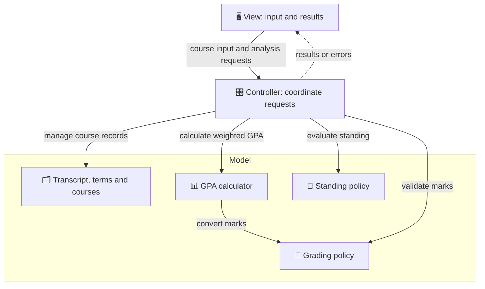

# 🎓 Academic Grade Analyzer

### Your courses. Your progress. A clearer picture.

Analyze course marks, calculate weighted GPAs, and understand academic standing.

**University of Regina · Software Testing and Validation**

[Team](#-meet-the-team) · [Overview](#-overview) · [Features](#-planned-features) · [Design](#-how-it-fits-together) · [Testing](#-built-with-testing-in-mind) 

---

## 👥 Meet the Team

| Zifran Chowdhury | Gabriel Sampaga | Mohammad Suhayb Hoolash |
| :---: | :---: | :---: |
| Team member | Team member | Team member |

## 📘 Overview

Courses carry different credit weights, and calculating a GPA by hand can get confusing. **Academic Grade Analyzer** is designed to organize course marks and credits, calculate term and cumulative GPAs, and evaluate academic standing using documented grading rules.

The project follows **Model-View-Controller (MVC)** architecture and **Test-Driven Development (TDD)**, with separate components for user interaction, academic data, calculations, and policy decisions.

## ✨ Planned Features

| | Feature | What it does |
| :---: | :--- | :--- |
| 🗂️ | **Course management** | Add, edit, and remove course records within academic terms. |
| ✅ | **Input validation** | Check course information before accepting it for analysis. |
| 📊 | **Term GPA** | Calculate a term's GPA using course credit weights. |
| 📈 | **Cumulative GPA** | Combine eligible courses across terms into a weighted GPA. |
| 🎯 | **Academic standing** | Evaluate standing using the project's documented policy. |
| 💬 | **Clear feedback** | Present results and explain invalid or incomplete input. |

## 🧩 How It Fits Together

The interface collects input, the controller coordinates requests, and the model manages academic data and rules.

Each component has a focused responsibility, making it easier to test calculations and policies independently of the interface.

## 🧪 Built With Testing in Mind

The testing plan covers both individual components and complete user workflows:

- **Boundary-value and equivalence-class testing** for marks, credits, and grade bands.
- **Decision-table testing** for academic-standing rules.
- **State-transition testing** for course changes and history-dependent standing rules where applicable.
- **Path and data-flow testing** for calculation and validation logic.
- **Integration and use-case testing** for the complete analysis workflow.

JUnit is planned for automated component tests. Test execution results will be recorded as implementation progresses.

## 📄 Project Report

See [REPORT.md](REPORT.md) for the requirements, design alternatives, selected architecture, component responsibilities, and testing plan.

---

**An ENSE 375 project at the University of Regina**

Calculated results are estimates and do not replace official university records or academic advising.

