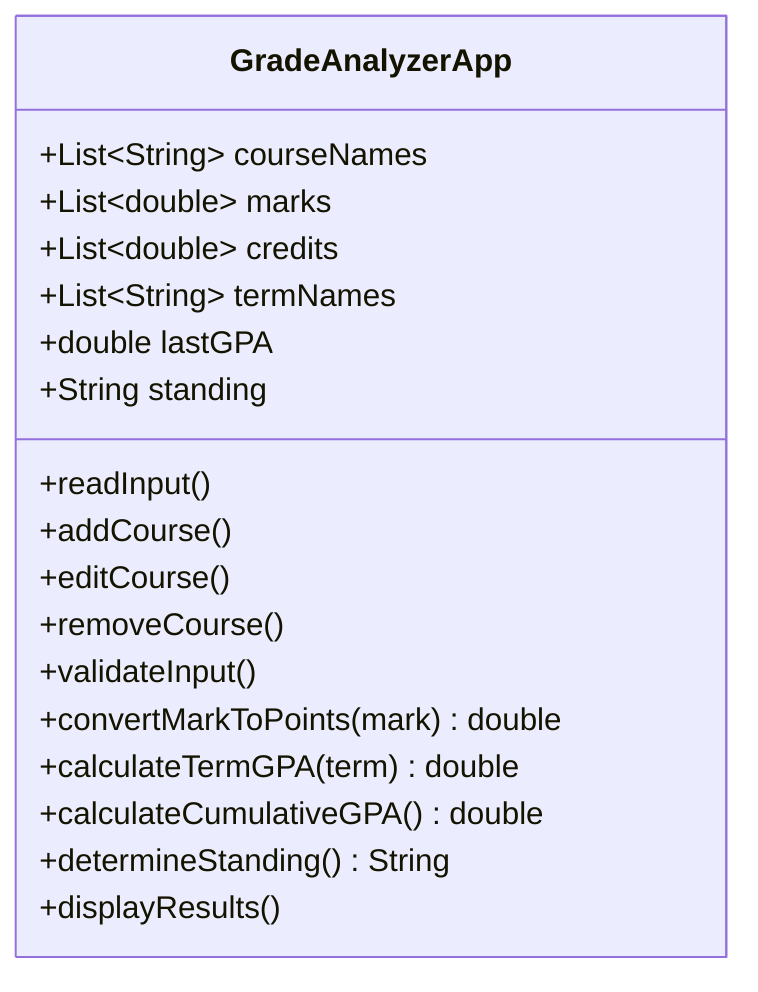
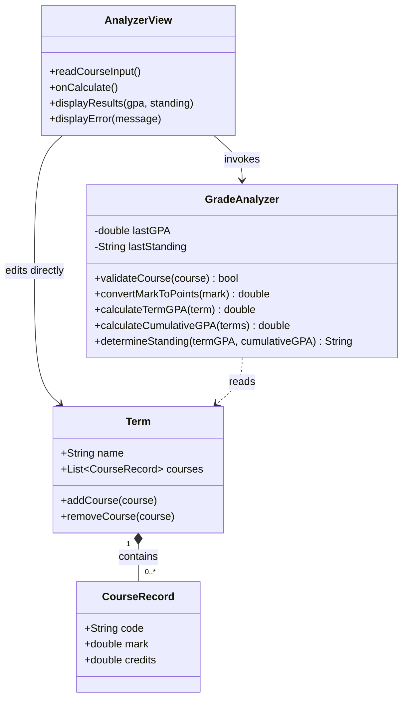
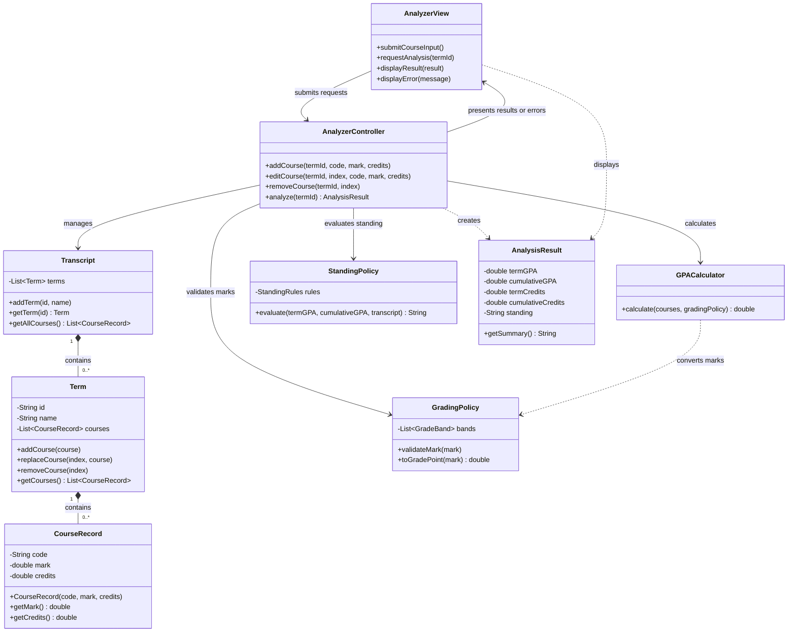

# ENSE 375 – Software Testing and Validation
# Academic Grade Analyzer

**Group 3 Members:**  
* Zifran Chowdhury (Student ID: 200502201)  
* Gabriel Sampaga (Student ID: 200426525)  
* Mohammad Suhayb Hoolash (Student ID: 200510097)  

---

## Table of Contents
* [1 Introduction](#1-introduction)
* [2 Design Problem](#2-design-problem)
  * [2.1 Problem Definition](#21-problem-definition)
  * [2.2 Design Requirements](#22-design-requirements)
    * [2.2.1 Functions](#221-functions)
    * [2.2.2 Objectives](#222-objectives)
    * [2.2.3 Constraints](#223-constraints)
* [3 Solution](#3-solution)
  * [3.1 Solution 1](#31-solution-1)
  * [3.2 Solution 2](#32-solution-2)
  * [3.3 Final Solution](#33-final-solution)
    * [3.3.1 Components](#331-components)
    * [3.3.2 Environmental, Societal, Safety, and Economic Considerations](#332-environmental-societal-safety-and-economic-considerations)
    * [3.3.3 Test Cases and Results](#333-test-cases-and-results)
    * [3.3.4 Limitations](#334-limitations)
* [4 Team Work](#4-team-work)
  * [4.1 Meeting 1](#41-meeting-1)
  * [4.2 Meeting 2](#42-meeting-2)
  * [4.3 Meeting 3](#43-meeting-3)
  * [4.4 Meeting 4](#44-meeting-4)
* [5 Project Management](#5-project-management)
* [6 Conclusion and Future Work](#6-conclusion-and-future-work)
* [7 References](#7-references)
* [8 Appendix](#8-appendix)

---

## 1 Introduction
Calculating semester and cumulative grade point averages (GPAs) by hand can be confusing and lead to calculation errors for university students. Because courses often have different credit weights, manual calculations can give students an inaccurate picture of their overall academic standing. 

The Academic Grade Analyzer is an application designed to calculate accurate term and cumulative GPAs based on course grades and credit weights. It also evaluates academic standing flags such as Good Standing or Academic Probation. 

This report documents the design process for the application.

---

## 2 Design Problem

### 2.1 Problem Definition
University students frequently miscalculate their GPAs when managing multiple courses with varying credit weights. Relying on manual arithmetic or basic spreadsheets often introduces errors, preventing students from understanding their true standing until official grades are posted. Without a simple, reliable tool to evaluate marks, students risk unexpected academic warnings or probation.

The goal of this project is to build an Academic Grade Analyzer that accepts course marks and credit values, accurately computes weighted term and cumulative GPAs, and determines academic standing according to university grading policies. The application must be deterministic, easy to run, and structured to allow thorough software testing.

### 2.2 Design Requirements
The Academic Grade Analyzer shall be designed to provide students with an accurate and reliable method of analyzing their academic performance.

#### 2.2.1 Functions
The Academic Grade Analyzer shall provide the functionality required to accept, validate, and analyze student academic information. The following functional and non-functional requirements define the expected behaviour and characteristics of the system.

**Functional Requirements:**
- The system shall allow users to enter the course name, course mark, and corresponding value for each course.
- The system shall validate that entered marks and credit values are within ranges before performing calculations.
- The system shall calculate the weighted term GPA based on the marks and credit values provided by the user.
- The system shall calculate cumulative GPA using previously completed courses and their corresponding credit values.
- The system shall determine the user's academic standing based on the applicable university grading policies.
- The system shall provide clear results that allow users to understand how their GPA and academic standing were determined.
- The system shall produce the same results when provided with the same valid input data.

**Non-Functional Requirements:**
- The system shall perform deterministic calculations without relying on external services during normal operations.
- The system shall provide clear error messages when invalid or incomplete information is entered.
- The system shall be simple enough for a university student to use without specialized technical knowledge.
- The system shall be structured in a manner that allows its calculations, input validation, and academic-standing logic to be independently tested.
- The system shall not require users to provide unnecessary personal or sensitive information to perform GPA calculations.

#### 2.2.2 Objectives
The primary objective of the Academic Grade Analyzer is to provide university students with a simple and reliable tool for analyzing their academic performance. The system is intended to reduce errors associated with manual GPA calculations and help students better understand their academic standing.

**The objectives of the system are to:**
- Provide students with an accurate method of calculating weighted term and cumulative GPA.
- Account for differences in course credit values when analyzing academic performance.
- Help students understand how their GPA and academic standing are determined.
- Reduce the likelihood of calculation errors associated with manual GPA calculations.
- Provide a straightforward interface that allows students to analyze their academic performance without specialized technical knowledge.
- Present calculated results in a clear and understandable manner.

#### 2.2.3 Constraints
**The design of the Academic Grade Analyzer is subject to the following constraints:**
#### Economic Factors
- The application shall be developed using freely available development tools and shall not require paid external services for its core functionality.

#### Security and Access
- The application shall not require access to official university records or student information systems.
- The application shall minimize the collection of personal or sensitive information and only require information necessary to perform academic calculations.

#### Reliability
- The application shall produce consistent and deterministic GPA and academic-standing results when provided with the same valid input data.
- The application shall validate course marks and credit values before performing calculations to reduce the possibility of incorrect results.

#### Ethics
- The application shall apply the predefined grading scale and academic-standing rules consistently to all users.
- The application shall clearly identify calculated GPA and academic-standing results as estimates and shall not present them as official university records.

#### Societal Impacts
- The application shall serve as an analytical aid to help students better understand their academic performance.
- The application shall not be presented as a replacement for official university academic advising or academic records.

#### Technical Constraints
- GPA calculations shall account for different course credit values rather than treating all courses as equally weighted.
- The application shall perform its core GPA and academic-standing calculations without relying on external services during normal operation.
---

# Academic Grade Analyzer — Three Design Alternatives

These UML class diagrams show progressively better software designs for the same scope: entering course marks and credits, calculating weighted term and cumulative GPA, and determining academic standing. The first two use valid UML notation but deliberately weak architecture. Exact grading thresholds and academic-standing rules must be agreed before implementation.

## Solution 1 — One overloaded class

**Description:** Everything is stored and performed by one class: input, course data, validation, grading rules, GPA calculations, standing, and display.

**What is useful:** It is quick to understand and can work as an initial proof of concept. Both GPA calculations and credit weights are represented.

**Why the design is bad:**

- The class has too many responsibilities, violating the Single Responsibility Principle.
- Public fields allow callers to bypass validation and change data directly.
- Separate lists can become inconsistent. Removing a course name but forgetting its mark associates data with the wrong course.
- Calculations are mixed with input and display, making independent unit tests difficult.
- Changing the grading scale or interface requires changing the same class.
- Stored results can become stale after course data changes.

**Testing consequence:** A GPA test may need to initialize unrelated UI and application state. Failures are harder to isolate.

## Solution 2 — Partial separation

**Description:** Course information is grouped into records, courses belong to terms, and the interface is separated from the analyzer.

**Improvements over Solution 1:**

- Each course keeps its code, mark, and credits together, removing the parallel-list problem.
- Terms explicitly group courses for term GPA; cumulative GPA can use multiple terms.
- Calculation methods are separated from display methods, making numerical tests easier.
- Named classes make the structure easier to understand and extend.

**Why it is still weak:**

- GradeAnalyzer still combines validation, mark conversion, GPA calculation, and standing rules.
- The view directly edits model data and invokes calculations, so there is no controller coordinating the workflow.
- Public marks, credits, and course lists allow invalid changes without validation.
- Grading and standing policies remain embedded in the analyzer.
- Cached GPA and standing can become stale after edits.

**Testing consequence:** Calculation tests improve, but policy changes and UI workflows remain coupled. Invalid data can enter the model through several routes.

## Solution 3 — MVC with focused model services

**Description:** The view collects input and presents output. The controller coordinates requests. The model consists of transcript data and focused GPA, grading, and standing services. The controller delegates business rules rather than implementing them itself.

**Improvements over Solution 2:**

- The controller gives the UI a single entry point for adding, editing, removing, and analyzing courses.
- Private fields protect data. CourseRecord construction rejects a missing code, non-finite numbers, and invalid credit values; GradingPolicy validates marks against the chosen scale before records are accepted.
- Course records are immutable after construction. Editing replaces a record with a validated replacement. Collection getters return read-only views or copies.
- GPACalculator has one task: calculate weighted GPA. The same method handles a selected term's courses and all completed courses.
- GradingPolicy owns mark conversion; StandingPolicy owns academic-standing rules. Either policy can change without rewriting the UI or GPA formula.
- Each analysis creates an immutable AnalysisResult, avoiding shared cached results that silently become outdated. The UI refreshes or clears displayed results after an edit.
- Transcript, Term, and CourseRecord have explicit ownership and multiplicities.

**Why this is a good design for the project:** It supports MVC, limits coupling, and makes validation, calculations, standing rules, and controller workflows independently testable. It remains small enough for the stated application scope.

**Implementation contracts:**

- Weighted GPA = sum of (grade points multiplied by GPA-eligible credits) divided by total GPA-eligible credits.
- An empty eligible course list produces a clear "GPA unavailable" response; it does not divide by zero or assume a GPA of zero.
- Retakes, pass/fail courses, rounding, grade boundaries, and standing thresholds must follow documented project policies.
- If standing depends on previous terms or standing, StandingPolicy uses the transcript history rather than GPA alone.
- GradeBand and StandingRules are configuration value types, omitted from this high-level diagram. No university thresholds are assumed here.

**Testing opportunities:** Test grade boundaries and invalid inputs; weighted GPA with unequal credits; term versus cumulative calculations; empty transcripts; policy decision tables; standing transitions where supported by the chosen policy; and controller-to-model integration.

## Comparison

| Aspect | Solution 1 | Solution 2 | Solution 3 |
|---|---|---|---|
| Responsibilities | All in one class | UI separated; analyzer overloaded | UI, coordination, data, and policies separated |
| Course storage | Parallel lists | Course records grouped into terms | Encapsulated transcript, terms, and records |
| Validation | Easy to bypass | Still bypassable through public fields | Controlled entry and validated records |
| MVC | Absent | Partial separation | Explicit MVC structure |
| Policy changes | Edit the application class | Edit the analyzer | Edit the relevant policy |
| Unit testing | Difficult to isolate | Easier calculations | Independently testable components |

Notation: `+` means public, `-` means private, a solid arrow shows a navigable association, a dashed arrow shows a dependency, and the filled diamond means composition. `1` to `0..*` means one owner may contain zero or more child objects.
#### 3.3.1 Components
#### 3.3.2 Environmental, Societal, Safety, and Economic Considerations
#### 3.3.3 Test Cases and Results
#### 3.3.4 Limitations

---

## 4 Team Work

### 4.1 Meeting 1
**Time:**  
**Agenda:** 

| Team Member | Previous Task | Completion State | Next Task |
| :--- | :--- | :--- | :--- | 
| Member 1 Name | N/A | N/A | N/A |
| Member 2 Name | N/A | N/A | N/A |
| Member 3 Name | N/A | N/A | N/A |

### 4.2 Meeting 2

### 4.3 Meeting 3

### 4.4 Meeting 4

---

## 5 Project Management

---

## 6 Conclusion and Future Work

## 7 References

## 8 Appendix
